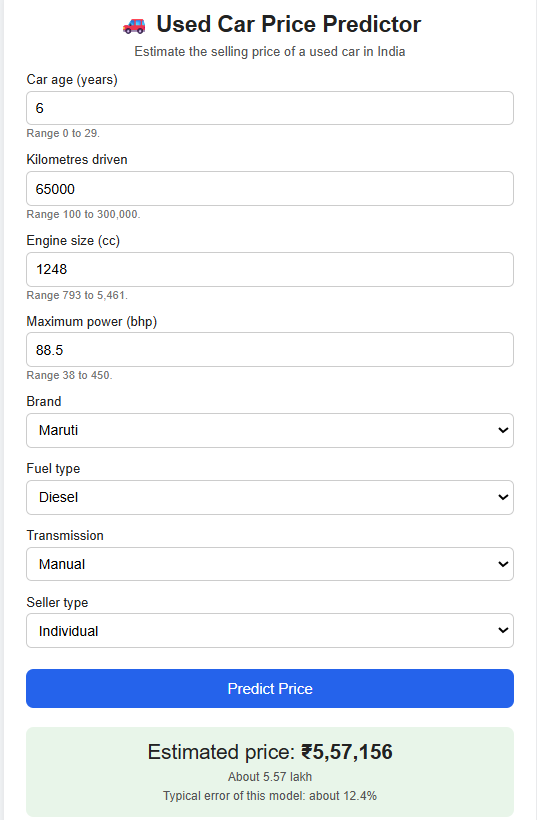

# 🚗 Used Car Price Predictor

Predicts the selling price of a used car in India using polynomial regression, and compares polynomial degrees 1 to 4.

## 🔗 Live Demo
**[Try the website here](https://anju-raman1.github.io/Car_Price_Predictor/)**

## Problem
Car prices depend on age, mileage, power, and brand in curved, overlapping ways, so a plain linear model can miss patterns. This project predicts a used car's price from its age, kilometres driven, engine size, power, brand, fuel type, transmission, and seller type, and tests whether polynomial regression does better than a linear model.

## Dataset
CarDekho used-car listings (about 15,000 cars, prices in rupees). Cars above 50 lakh rupees or with more than 300,000 km were removed, duplicates were dropped, and rare brands were grouped as "Other". After cleaning, about 15,000 cars remained.

## Approach
- The target is the **log of the price**, because prices are right-skewed. Predictions are converted back to rupees.
- Numeric features (age, km, engine, power) are scaled and expanded into polynomial terms.
- Categorical features (brand, fuel, transmission, seller) are one-hot encoded.
- A Ridge regression is fitted on top, and the best degree is chosen with 5-fold cross-validation.

## Results
| Degree | Test R² | Median error | Average error (MAE) |
|---|---|---|---|
| 1 (linear) | 0.875 | 14.1% | ₹137,570 |
| 2 | 0.895 | 13.0% | ₹116,375 |
| 3 | 0.900 | 12.6% | ₹116,611 |
| 4 | 0.899 | 12.4% | ₹112,920 |

R² is calculated on the log price. Median error is the typical percentage difference between predicted and actual price.

## Key Findings
- Polynomial regression beat the linear (degree 1) model: the median error fell from 14.1% to 12.4%, and the average error fell by about 18%.
- Most of the gain came from degree 2. Degrees 3 and 4 performed almost the same (cross-validated R² of 0.902 for both), so a simpler degree 2 or 3 model would also be reasonable.
- Engine power and car age are the strongest numeric drivers of price.
- The model is least accurate for the cheapest cars (median error 16%) and most accurate for the upper-middle price band (10%).

## How the Website Works
The learned numbers (scaling values, polynomial powers, and coefficients) are exported to `model.json`. `index.html` repeats the same steps in JavaScript, so no Python server is needed. It is hosted for free on GitHub Pages.

## Limitations
- Prices come from one period of CarDekho listings, not today's market.
- Only mainstream cars (up to 50 lakh) are covered.
- Condition, accident history, city, and the exact car model are not included.

## Tech Stack
Python, pandas, NumPy, Matplotlib, Seaborn, scikit-learn, HTML, JavaScript, GitHub Pages

## Files
- `car_price_prediction.ipynb`: full analysis and model export
- `index.html`: the website
- `model.json`: the exported model

## Author
Anju-Raman1 | [GitHub](https://github.com/Anju-Raman1)
